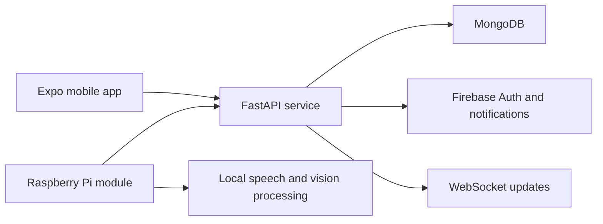

<div align="center">
  

  <p>
    
    
    
    <a href="LICENSE"></a>
  </p>
</div>

## 💜 What it is

Aura is a multi-part memory-care companion prototype: a mobile app, a FastAPI backend, and an optional Raspberry Pi module for local voice and camera processing. The repository brings together patient and caregiver flows, reminders, memory records, and service integrations.

## 🧩 System overview



## ✨ Project areas

- The Expo app contains patient/caregiver-facing screens and notification flows.
- The API provides authentication, persisted records, and realtime endpoints.
- The `auramodule/` directory contains edge-side Python components for camera/voice workflows.
- The `rules/` directory holds project behavior and care-flow material.

## 🧰 Stack

| Area | Tools |
|---|---|
| Mobile | Expo 55, React Native, TypeScript, Expo Router |
| API | Python, FastAPI, Uvicorn, Beanie/MongoDB |
| Identity and notifications | Firebase Auth, Firebase messaging |
| Edge prototype | Python, OpenCV, faster-whisper, InsightFace |
| Realtime | WebSockets |

## 🚀 Start the app

Install frontend dependencies and run Expo:

```bash
git clone https://github.com/ChristopherJoshy/Aura.git
cd aura/frontend
npm install
npm run start
```

The backend and edge module have separate Python requirements and environment settings. Configure Firebase, MongoDB, and provider credentials from the relevant example files before starting those services. Run device-only camera, microphone, notification, and location flows on supported hardware.

## 🗂️ Layout

```text
frontend/    Expo app
backend/     FastAPI service
auramodule/  edge-device scripts and processing
rules/       product and care-flow rules
```

## 📄 License

MIT. See [`LICENSE`](LICENSE).

## ⚠️ Scope and privacy

This is a software prototype, not a medical device or substitute for professional care. The project handles sensitive health, location, voice, and image data; do not use real patient data without appropriate consent, access controls, retention rules, and security review.